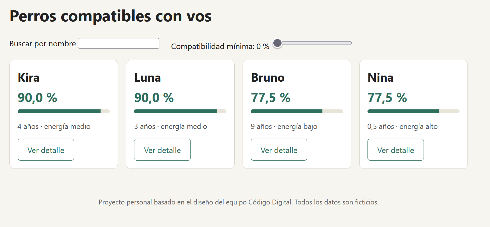
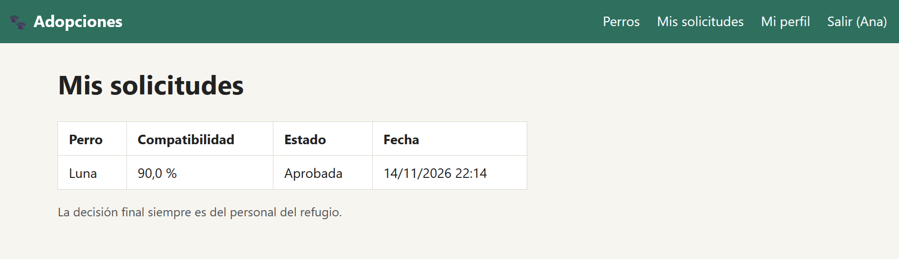
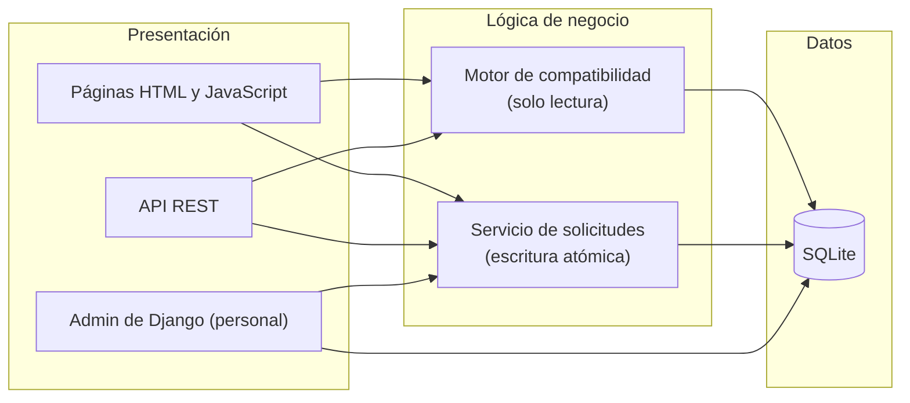

# Adopciones — sistema de matching adoptante–perro


**English summary:** Django web app for a dog shelter. Adopters fill in a questionnaire and the system ranks the available dogs by compatibility (exclusion filters + weighted, configurable criteria; no AI). Shelter staff manage dogs and approve requests from the Django admin. Includes a REST API, a JavaScript page that consumes it, 47 automated tests and CI with GitHub Actions. Personal project based on an academic design; all data is fictional.





## Qué es

Aplicación web para un refugio de perros. Cada adoptante completa un cuestionario sobre su hogar y su estilo de vida, y el sistema le muestra los perros disponibles **ordenados por compatibilidad**, con el detalle de cómo se calculó cada porcentaje. El adoptante puede solicitar un perro y el personal del refugio aprueba o rechaza las solicitudes. **La decisión final siempre es del personal.**

## Cómo calcula la compatibilidad

El **motor de compatibilidad** trabaja en dos pasos y no usa inteligencia artificial: son reglas configurables.

1. **Filtros excluyentes.** Se descartan los perros que no pueden convivir con niños, con otras mascotas o en departamento cuando el adoptante lo necesita. Un perro excluido no recibe porcentaje y no se muestra.
2. **Porcentaje ponderado.** Para el resto se calcula:

   `% = puntos obtenidos ÷ suma de pesos activos × 100`

| Criterio | Peso inicial | Cómo se puntúa |
|---|---|---|
| Energía | 30 | 1 si el nivel coincide, 0,5 si difiere en un nivel, 0 si difiere en dos |
| Experiencia | 25 | Según cuánta experiencia le falta al adoptante respecto de la que pide el perro |
| Espacio | 20 | Según cuánto espacio le falta al adoptante respecto del que necesita el perro |
| Edad | 15 | Cachorro (menos de 2 años), adulto (2 a 7) o mayor (8 o más) frente a la preferencia |
| Preferencias | 10 | Proporción de preferencias marcadas que el perro cumple |

Los pesos son **iniciales y configurables** desde el admin: no hace falta que sumen 100, y el resultado siempre queda entre 0 y 100.

## Arquitectura



```
adopciones-django/
├── config/                  # configuración del proyecto (settings, urls)
├── adopciones/
│   ├── models.py            # Perro, Adoptante, Criterio, Solicitud
│   ├── admin.py             # gestión del personal: aprobar/rechazar, pesos
│   ├── forms.py, views.py, urls.py
│   ├── services/
│   │   ├── motor.py         # motor de compatibilidad (solo lectura)
│   │   └── solicitudes.py   # crear, aprobar y rechazar solicitudes
│   ├── api/                 # API REST (Django REST Framework)
│   ├── templates/, static/  # páginas, estilos y JavaScript
│   ├── fixtures/            # datos ficticios de prueba
│   └── tests/               # 47 tests automáticos
├── docs/                    # capturas y bitácora
├── Dockerfile
└── .github/workflows/       # tests automáticos (GitHub Actions)
```

## Decisiones de diseño

- **Motor de solo lectura.** El motor nunca crea, modifica ni borra datos; la escritura vive en un módulo aparte. Un test comprueba que solo ejecuta consultas `SELECT`.
- **Aprobación atómica.** Se aprueba **una solicitud por perro**. Al aprobar, en una sola transacción la solicitud queda aprobada, el perro pasa a «en proceso» y las otras solicitudes de ese perro se rechazan. Si algo falla a mitad de camino, no queda nada a medias (hay un test que lo simula).
- **Filtros antes que puntajes.** Primero se excluye lo que no es compatible y después se puntúa, para no mostrar perros que el adoptante no podría adoptar con un porcentaje bajo.
- **Porcentaje con detalle.** Cada solicitud guarda el porcentaje y los puntos por criterio del momento en que se hizo.

## Estado del proyecto

- [x] Etapa 0: preparación del repositorio
- [x] Etapa 1: modelo de datos y admin
- [x] Etapa 2: motor de compatibilidad con tests
- [x] Etapa 3: lado del adoptante (cuestionario y listado)
- [x] Etapa 4: solicitudes y aprobación
- [x] Etapa 5: pesos configurables
- [x] Etapa 6: API REST y frontend en JavaScript
- [x] Etapa 7: tests automáticos, documentación y capturas
- [ ] Etapa 8 (opcional): acceso con email y código de un solo uso

## Tecnologías

Python 3 · Django · Django REST Framework · SQLite · HTML · CSS · JavaScript · GitHub Actions · Docker

## Cómo ejecutarlo

Requisitos: Python 3.12 o superior.

**Windows (PowerShell)**
```powershell
git clone https://github.com/Julienzo27/adopciones-django.git
cd adopciones-django
python -m venv .venv
.venv\Scripts\Activate.ps1
pip install -r requirements.txt
python manage.py migrate
python manage.py loaddata datos_ficticios
python manage.py createsuperuser
python manage.py runserver
```

**Linux / macOS**
```bash
git clone https://github.com/Julienzo27/adopciones-django.git
cd adopciones-django
python3 -m venv .venv
source .venv/bin/activate
pip install -r requirements.txt
python manage.py migrate
python manage.py loaddata datos_ficticios
python manage.py createsuperuser
python manage.py runserver
```

Después abrir http://127.0.0.1:8000/ (sitio) y http://127.0.0.1:8000/admin/ (personal del refugio).

### Datos de prueba

Los adoptantes ficticios se ingresan solo con su email (por ahora no hay código de verificación):

| Adoptante | Email | Qué muestra |
|---|---|---|
| Ana | ana@mail.com | Caso válido: departamento, sin niños ni mascotas |
| Beto | beto@mail.com | Con niños y otras mascotas: varios perros quedan excluidos |
| Carla | carla@mail.com | Perfil incompleto: la lleva a completar el cuestionario |

## API REST

Usa la misma sesión del adoptante. Las operaciones que modifican datos exigen el token CSRF.

| Método y ruta | Qué hace |
|---|---|
| `GET /api/perros/compatibles/` | Perros compatibles del adoptante, de mayor a menor porcentaje |
| `GET /api/perros/<id>/` | Un perro compatible con el desglose del cálculo |
| `GET /api/solicitudes/` | Solicitudes del adoptante |
| `POST /api/solicitudes/` | Crea una solicitud (`{"perro": <id>}`) |

Respuestas: `401` sin sesión, `409` si el perfil está incompleto o la regla no lo permite, `404` si el perro no está disponible para esa persona.

## Tests

```bash
python manage.py test
```

47 tests que cubren el motor (con los valores calculados a mano), las páginas, las solicitudes y su atomicidad, los pesos configurables y la API. Se ejecutan automáticamente en cada `push` con GitHub Actions, en Python 3.12, 3.13 y 3.14.

## Docker (demostración)

```bash
docker build -t adopciones .
docker run --rm -p 8000:8000 \
  -e DJANGO_SUPERUSER_USERNAME=admin \
  -e DJANGO_SUPERUSER_PASSWORD=elegi-una-clave \
  -e DJANGO_SUPERUSER_EMAIL=admin@example.com \
  adopciones
```

La imagen usa el servidor de desarrollo de Django y una base SQLite dentro del contenedor, que se pierde al detenerlo. Es solo para probar el proyecto, no para producción.

## Limitaciones y próximos pasos

- El ingreso del adoptante es solo con el email. El diseño original prevé un código de un solo uso en cada ingreso (Etapa 8).
- Los pesos iniciales no están calibrados con datos reales.
- Usa el servidor de desarrollo y SQLite: faltaría configuración de producción (base de datos, archivos estáticos, variables de entorno).

## Origen y créditos

El diseño original (requerimientos, arquitectura, modelo de datos y prueba de concepto) fue elaborado por el equipo **Código Digital** (María Rita Zumbo, Jimena Obella y Samanta Godoy) para Prácticas Profesionales III, IFTS N° 12. Esta implementación en Django es un desarrollo personal posterior.

## Uso de IA

Parte del código se escribió con ayuda de Claude (IA) y fue revisado, probado y ejecutado por la autora.

## Datos

Todos los adoptantes y perros son ficticios.

## Licencia

MIT
